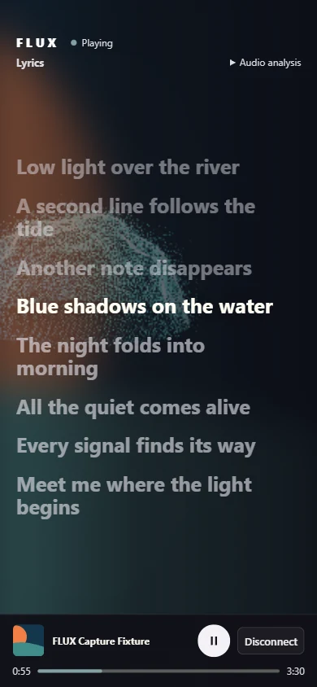

# FLUX

**Music you can see.** FLUX turns a YouTube tab into a listening theater. Singularity responds to the captured audio, the video artwork colors the room, and lyrics follow the playback clock.

[**Try the live demo**](https://pranav-teja-aluvala.github.io/FLUX/#demo) · [**Download for Chrome**](https://pranav-teja-aluvala.github.io/FLUX/downloads/FLUX-Chrome.zip) · [**Windows x64**](https://github.com/Pranav-Teja-Aluvala/FLUX/releases/download/v1.4.3/FLUX-Windows-x64.zip)


## Tour

| Browse lyrics at your own pace | The listening view on a narrow screen |
| --- | --- |
|  |  |

These screenshots were captured in Chrome with a controlled track, original fixture lyrics, and actual tab audio capture.

- **Follow playback.** The current line eases into view. Scroll to browse, click a lyric to seek, or select **Follow lyrics** to return to the current line.
- **See the frequency history.** Switch to **Spectrum** for a circular spectrogram driven by captured audio. The rim and trails pick up the current video's artwork colors. Current sound lights the inner edge and older sound fades outward. Drag to rotate it in the [browser demo](https://pranav-teja-aluvala.github.io/FLUX/#demo).
- **Keep reading on edits.** FLUX matches exact recordings against [LRCLIB](https://lrclib.net/). When the first lookup misses, it can compare likely songs with YouTube captions and align a confirmed section. Caption tracks with word timings highlight words as they arrive.
- **Listen locally.** The optional Windows companion uses Hybrid Demucs, Whisper, and SepFormer to separate voices and transcribe English audio. Audio processing stays on the device.

## Install the Chrome extension

1. Download and extract [FLUX-Chrome.zip](https://pranav-teja-aluvala.github.io/FLUX/downloads/FLUX-Chrome.zip).
2. Open `chrome://extensions`, enable **Developer mode**, and choose **Load unpacked**. Select the folder containing `manifest.json`.
3. Play a video on YouTube, then click the FLUX toolbar icon.

| Control | Action |
| --- | --- |
| Space | Play or pause the linked video |
| ← / → | Skip five seconds |
| F | Toggle fullscreen |
| Follow lyrics | Resume automatic lyric scrolling |

For the Windows listening companion, run `listening/Install-Listening.ps1` from the extracted folder using 64-bit Python 3.10–3.13. The optional `-PrepareModels` flag fetches the model weights during setup. In FLUX, enable it under **Audio analysis**. **Show local captions** lets you switch from synced lyrics to the model's output. Results arrive after each five-second sample plus processing time, and dense mixes may produce inaccurate words.

Under **Audio analysis → Caption language**, choose **Automatic** or select a language. The Windows companion uses the multilingual Whisper model to transcribe in the original language. In overlapping-speaker modes, Automatic detects the language independently for each separated voice. Short clips and singing can be harder to identify, so use the language override when needed. The browser's local speech recognition uses your browser language in Automatic mode and requires an available language pack. YouTube captions and synced lyrics follow the source text. If you installed the Windows companion before Chrome extension 1.4.4, run the installer from the updated download to enable multilingual analysis.

## Build and test

```sh
npm ci
npm test
npm run extension
npm run site:build
python scripts/archive-extension.py
```

The unpacked Chrome extension builds to `dist-extension/`. The static site and its download build to `dist-pages/`. Run `npm run site:dev` for the landing page or `npm run desktop` for the Electron build. To open the landing page directly from disk with the interactive demo, run `npm run site:preview-file` and open `site/index.html`.

React and TypeScript render the listening interface. Three.js renders Singularity and the live spectrum from Web Audio data. GSAP handles lyric follow, the landing page entrance, and demo scene transitions. Motion respects the system’s reduced-motion setting.

[ISC license](LICENSE)
