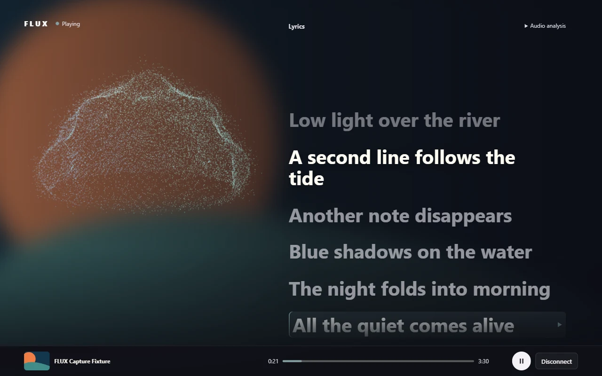
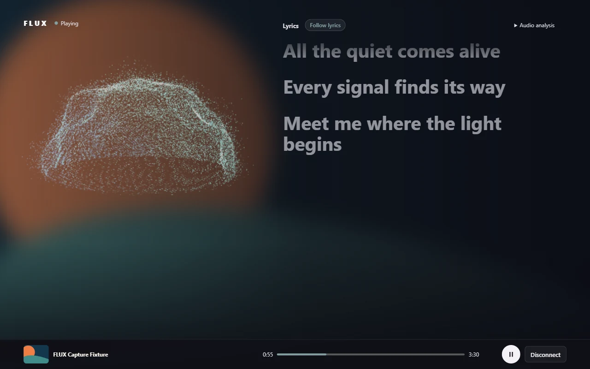
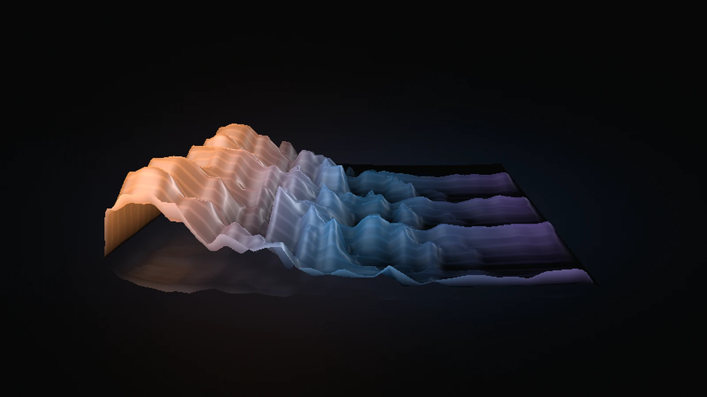
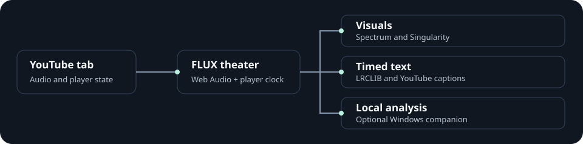

# FLUX

**Music you can see.** FLUX turns a YouTube tab into a listening theater with audio-reactive visuals, artwork colors, synced lyrics, and optional local captions.

[**Download Chrome 1.4.5**](https://pranav-teja-aluvala.github.io/FLUX/downloads/FLUX-Chrome.zip) · [**Play the demo**](https://pranav-teja-aluvala.github.io/FLUX/#demo) · [SHA-256](https://pranav-teja-aluvala.github.io/FLUX/downloads/FLUX-Chrome.zip.sha256)



## The listening theater

| Timed lyrics | Spectrum |
| --- | --- |
|  |  |
| Follow the active line, scroll ahead, or click a line to seek. | The inner edge shows current frequencies, and the outer rings show recent history. |

The theater screenshots were captured in Chrome with actual tab audio, a controlled track, and original fixture lyrics. The Spectrum frame is from the running FLUX demo.

<details>
<summary>Narrow listening layout</summary>

</details>

- Singularity reacts to the music. Spectrum renders a circular spectrogram. Both use colors sampled from the current video's thumbnail.
- LRCLIB supplies synced lyrics when FLUX finds a matching recording. FLUX can also display YouTube captions and align modified recordings when there is enough timing evidence.
- The optional Windows companion transcribes locally using multilingual Whisper. Choose a language under **Audio analysis** or let the model detect it.
- Use **Space** to pause or play, **← / →** to skip five seconds, and **F** for fullscreen.

## Install in Chrome

1. Extract [FLUX-Chrome.zip](https://pranav-teja-aluvala.github.io/FLUX/downloads/FLUX-Chrome.zip).
2. In `chrome://extensions`, enable **Developer mode** and choose **Load unpacked**. Select the extracted **FLUX Chrome Extension** folder that contains `manifest.json`.
3. Open a YouTube video and click FLUX in the Chrome toolbar.

To update an unpacked copy, extract the new ZIP over the same folder and use **Reload** on the extension card. To verify the ZIP on Windows, compare `Get-FileHash .\FLUX-Chrome.zip -Algorithm SHA256` with the [published checksum](https://pranav-teja-aluvala.github.io/FLUX/downloads/FLUX-Chrome.zip.sha256).

### Optional Windows listening companion

Run `listening/Install-Listening.ps1` from the extracted extension folder using 64-bit Python 3.10–3.13. Enable **Vocals and backing** or an overlapping-speaker mode under **Audio analysis**. Choose **Show local captions** to switch away from synced lyrics when both sources are available.

The companion reads five-second audio windows. Tone-only detection skips model weights. Hybrid Demucs loads for mixed audio, Whisper loads when there is likely speech, and the selected SepFormer model loads only for overlapping voices. The installer flag `-PrepareModels` downloads all of the weights up front. Short clips, singing, and dense mixes can produce incomplete or inaccurate captions. Browser speech recognition depends on Chrome's available local language packs.

### Windows desktop mode

[Download the portable Windows x64 build](https://github.com/Pranav-Teja-Aluvala/FLUX/releases/download/v1.4.3/FLUX-Windows-x64.zip). Extract the complete ZIP, open `FLUX.exe`, and choose **Desktop audio** for system playback. The desktop build has its own 1.4.3 version. Chrome 1.4.5 is the current listening theater.

### YouTube Link for Chrome

[Download YouTube Link](https://github.com/Pranav-Teja-Aluvala/FLUX/releases/download/v1.4.3/FLUX-YouTube-Link.zip) to supply YouTube player metadata to the Windows desktop app. Load the extracted `browser-helper` folder as an unpacked extension and click its icon on the source tab. The main Chrome FLUX extension already links directly to its source tab.

## How it works



React and TypeScript render the theater. Web Audio supplies the frequency data, Three.js draws the visuals, and GSAP brings the active lyric into view. Chrome captures audio from the linked tab. FLUX contacts YouTube's image CDN for thumbnails and LRCLIB for timed lyric searches. The optional companion receives audio through Chrome Native Messaging and processes it on the device.

## Build and verify

```sh
npm ci
npm test
npm run extension
npm run site:build
python scripts/archive-extension.py
```

Use Node.js 24 and Python 3.11+ for this build. The unpacked extension is in `dist-extension/`. GitHub Pages publishes `dist-pages/` with the ZIP and checksum. Use `npm run site:dev` to work on the landing page. For a direct file preview, run `npm run site:preview-file` before opening `site/index.html`. Use `npm run desktop` for the Electron build.

[ISC license](LICENSE)
