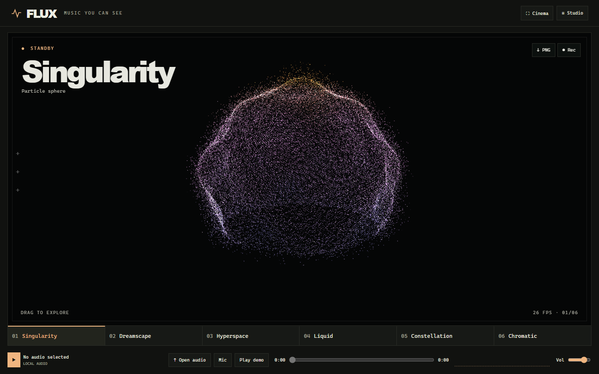

# FLUX — Music you can see

FLUX is a browser instrument for turning sound into real-time WebGL environments. Open a local track, enable the microphone, or play **Phase Zero**, the included original synth loop.

## Listening view

- Open **Sharing and inputs** at the bottom and select **Share video + audio**. In Chrome, choose the tab playing music and enable **Share tab audio**. The right pane shows the real shared feed. On Windows, select a player window or display in the portable app.
- Switch between **Singularity** and **Chromatic** in the center. Chromatic maps actual FFT bins to a labeled log-frequency axis, with peak holds and a quiet baseline.
- The visualizer follows the colors sampled from the visible video. When Windows reports cover art, switch the right pane to **Album art** to use its colors instead.
- On the left, search for a timed recording through LRCLIB or load a local LRC. Windows media sessions and local audio files supply a playback clock. For browser capture and mixes, enter the actual song and click a lyric as you hear it to align the timeline. The Earlier and Later buttons adjust the offset.
- **Space** toggles local playback or stops live input. **F** opens Cinema and **Escape** exits. Drag the visualization to orbit. PNG and Rec capture the visualizer canvas.

Only an explicit lyrics search sends song and artist names to LRCLIB. Video frames, audio, and color extraction stay local. The browser controls its own screen-sharing indicator.

## Development

Requires Node 22.12+ (or Node 24).

~~~sh
npm ci
npm run dev
npm test
npm run build
~~~

React and TypeScript handle the studio controls. Three.js and GLSL render outside React's render cycle. The audio engine reuses FFT and waveform buffers, estimates beat onsets from a rolling bass baseline, and never routes the microphone to the speakers. The graphics chunk loads on demand and reduces pixel ratio and point count when frame rate drops. Audio and presets are processed locally. Serve the build over HTTPS for microphone input.

Beat detection is approximate. Capture formats depend on browser codecs. Reduced motion freezes automatic camera and procedural travel while preserving the connection to live sound. There is no requirement to upload audio or sign in.

To regenerate the original demo, run the Python standard-library script from the repository root.

~~~sh
python generate-demo.py
~~~

## Windows desktop mode

Use this mode for FLUX to read the current Windows media session and follow its album artwork. Windows 10 version 1809 or later (or Windows 11) and an up-to-date Node installation are required.

~~~sh
npm ci
npm run desktop
~~~

Play music in your usual player, then open **Sharing and inputs**, choose your player window, and select **Share video + audio**. The first launch downloads the Electron runtime. FLUX reads metadata and artwork from the active Windows media session, with audio captured from Windows loopback. Audio from other apps using the same output can also affect the visualization. Use **Stop sharing** to stop capture and metadata polling. Turn off **Use image colors** in Studio to keep your chosen palette.

Players decide what they publish to Windows. When a player provides a title but no cover, FLUX displays the title and uses the selected scene palette. The hosted browser build can capture shared audio from a tab or screen when offered by the browser. Windows song detection and cover colors are available in the Windows app.
